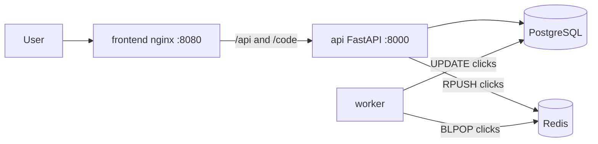

# DevOps Platform: URL Shortener on Kubernetes

A deliberately small app (API + worker + frontend + PostgreSQL + Redis) used to demonstrate production-grade delivery: containers, CI, IaC, GitOps, observability and security.

| Phase | Scope | Status |
|-------|-------|--------|
| 1 | App, Dockerfiles, docker-compose, CI | Done |
| 2 | Terraform (VPC, EKS, RDS, GitHub OIDC) | Planned |
| 3 | Helm + Argo CD GitOps on kind (free) | Done, see [docs/PHASE3.md](docs/PHASE3.md) |
| 4 | Observability, Argo Rollouts, alerts, runbooks | Planned |
| 5 | Security hardening, docs polish | Planned |

## Architecture


## Quick start (local, free)
```bash
make up      # build and start everything
make smoke   # create a short link, follow it, read the click count
make down
```
UI: http://localhost:8080 | API docs: http://localhost:8000/docs

## Kubernetes (kind, free)
```powershell
.\scripts\kind-up.ps1 ; .\scripts\deploy-local.ps1 ; .\scripts\smoke.ps1
```
Helm chart with probes, resource limits, HPA, PDB, NetworkPolicies and non-root read-only containers. GitOps mode with Argo CD is described in [docs/PHASE3.md](docs/PHASE3.md).

## Practices demonstrated (Phase 1)
- Multi-stage Docker builds, non-root numeric UID, pinned base images, HEALTHCHECKs
- CI: ruff, hadolint, unit tests, gitleaks, Trivy (fails on CRITICAL), compose validation
- Images tagged with the Git SHA only, pushed to GHCR from `main` with SBOM + provenance
- Dependabot, CODEOWNERS, PR/issue templates, ADRs

## Branch protection (GitHub settings)
Require PR + 1 review, required checks (`lint`, `test`, `secrets-scan`, `build-scan`), linear history, no force pushes, signed commits.
